  
  
  
  
  

## 01 · About

I'm Steven Coochin, known across the developer community as **DeveloperSteve**. I've spent 30+ years in software, across enterprise platforms and developer relations roles at **IBM, PayPal, Xero, Telstra, Snyk, GitLab and NGINX**. Along the way I've given 291 conference talks, written 600+ articles and tutorials, and organised global hackathons with partners including the United Nations.

Today I'm Co-CEO and CTO of a startup that's still in stealth, and Technical Director at [Clermont Digital](https://clermontdigital.com.au), the agency I co-founded with my partner Emma. I made [MysteryOS](https://mysteryos.app), a puzzle-survival game where every level drops you into an alien operating system, and [Settle Sound](https://settlesound.com), an app of binaural beats and calm tones for winding down. I also co-founded [PlotPlan.land](https://plotplan.land) and [FeedFinda](https://feedfinda.com.au), have a podcast on the way, and teach free short courses on [Muster Learn](https://learn.muster.life).

I do all of it from an off-grid property outside Clermont in Central Queensland. The enterprise-grade experience came with me. The commute didn't.

## 02 · What I'm building

  
  
  
  
  
  
  
  
  

## 03 · Worked with

## 04 · Toolbox

<table>
  <tr><td><b>Languages</b></td><td>           </td></tr>
  <tr><td><b>Web &amp; backend</b></td><td>            </td></tr>
  <tr><td><b>APIs &amp; SDKs</b></td><td>     </td></tr>
  <tr><td><b>Apps &amp; games</b></td><td>       </td></tr>
  <tr><td><b>Data &amp; messaging</b></td><td>       </td></tr>
  <tr><td><b>Cloud &amp; DevOps</b></td><td>        </td></tr>
  <tr><td><b>CI/CD</b></td><td>    </td></tr>
  <tr><td><b>Testing</b></td><td>    </td></tr>
  <tr><td><b>Observability &amp; security</b></td><td>      </td></tr>
  <tr><td><b>IoT &amp; hardware</b></td><td>           </td></tr>
</table>

## 05 · Talks & media

A few from the 291:

<table>
  <tr>
    <td width="33%" valign="top"> <b>Building, Deploying and Observing SDKs as a Service</b> Conf42 DevOps 2023</td>
    <td width="33%" valign="top"> <b>Building a Serverless-powered IoT Buzzwire Game</b> ServerlessDays ANZ</td>
    <td width="33%" valign="top"> <b>Find vulns in your code before they find you</b> Cloud with Chris</td>
  </tr>
</table>

🎙️ Podcast: [Voxgig, Ep 97: Steve Coochin](https://open.spotify.com/episode/3WSAHmqgra0Q9sdCliIfBy)

## 06 · Latest writing

<!-- LATEST-WRITING:START -->
- [Your business grew. Did your systems?](https://clermontdigital.com.au/blog/your-business-grew-did-your-systems) Clermont Digital · 10 Aug 2026
- [Clermont Digital just tripled, and our newest developer never had to leave town](https://clermontdigital.com.au/blog/clermont-digital-just-tripled-and-our-newest-developer-never-had-to-leave-town) Clermont Digital · 2 Aug 2026
- [Held to domain ransom](https://clermontdigital.com.au/blog/held-to-domain-ransom) Clermont Digital · 9 Jul 2026
- [When the flood takes your electronics, you build something better](https://clermontdigital.com.au/blog/when-the-flood-takes-your-electronics-you-build-something-better) Clermont Digital · 2 Jun 2026
- [How MysteryOS turned an alien operating system into a puzzle game](https://clermontdigital.com.au/blog/how-mysteryos-turned-an-alien-operating-system-into-a-puzzle-game) Clermont Digital · 13 Mar 2026
- [Who actually holds the keys to your business?](https://clermontdigital.com.au/blog/who-holds-the-keys-to-your-business) Clermont Digital · 2 Mar 2026
<!-- LATEST-WRITING:END -->

Refreshed daily from <a href="https://medium.com/@developersteve">Medium</a> and the <a href="https://clermontdigital.com.au/blog">Clermont Digital blog</a>.

## 07 · Off-grid

Home is a tiny, solar-powered smart house off the grid, and it doubles as my test bench. Home Assistant runs the place, with ESPHome sensors, a local weather station and solar and battery monitoring feeding it. When a flood took out our electronics, I [built something better](https://clermontdigital.com.au/blog/when-the-flood-takes-your-electronics-you-build-something-better). The 3D printer handles the parts that don't exist yet.

